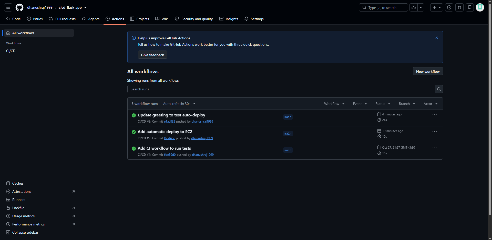
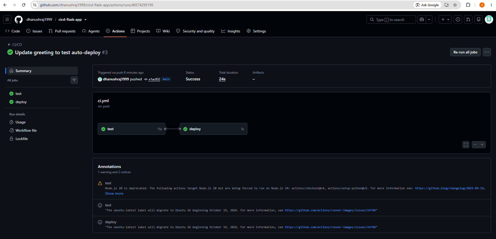

# CI/CD Pipeline: Flask App Deployed to AWS EC2

A small Flask app with a fully automated CI/CD pipeline. Every push to `main` runs the tests, then deploys the app to an AWS EC2 server running in Docker, with no manual steps.

## Pipeline flow

Push to GitHub -> GitHub Actions runs `pytest` -> if tests pass, the deploy job connects to EC2 over SSH -> pulls the latest code -> rebuilds the Docker image -> restarts the container

If the tests fail, the deploy job never runs.

## Tech stack

- Python 3.12, Flask, Gunicorn
- Pytest for automated tests
- Docker for packaging the app
- GitHub Actions for CI/CD
- AWS EC2 (Amazon Linux 2023) inside a custom VPC

## How it works

1. **Test job:** checks out the code, installs dependencies, runs `pytest`.
2. **Deploy job:** runs only on pushes to `main` and only after the test job succeeds. It logs in to EC2 with an SSH key stored as a GitHub Actions secret, runs `git pull`, builds the Docker image, and restarts the container on port 80.
3. **Secrets:** `EC2_HOST`, `EC2_USER`, and `EC2_SSH_KEY` are stored as encrypted repository secrets. No credentials are kept in the code.

## Project files

- `app.py`: the Flask app
- `test_app.py`: automated tests
- `Dockerfile`: container build
- `.github/workflows/ci.yml`: the pipeline

## Screenshots

**Pipeline runs (all green)**

**Test and deploy jobs**

**Live site after an automatic deploy**

## Problems I solved

- **Deploy job timed out on SSH:** the EC2 security group allowed port 22 only from my own IP. GitHub's runners connect from other addresses, so I opened port 22 for the demo.
- **Windows setup issues:** fixed the PowerShell execution policy for the virtual environment and the Python PATH setup.

## Possible improvements

- Push images to a registry (Docker Hub or ECR) instead of building on the server
- Add a vulnerability scan on the image (Trivy)
- Use an Elastic IP and HTTPS
- Use AWS Systems Manager instead of open SSH
